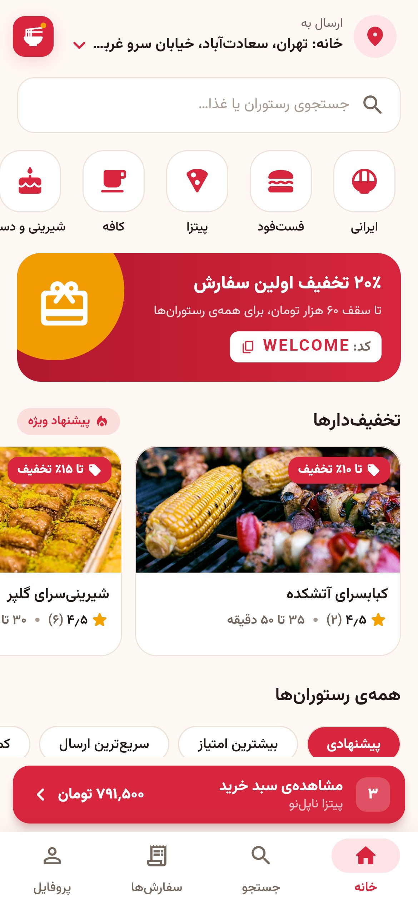
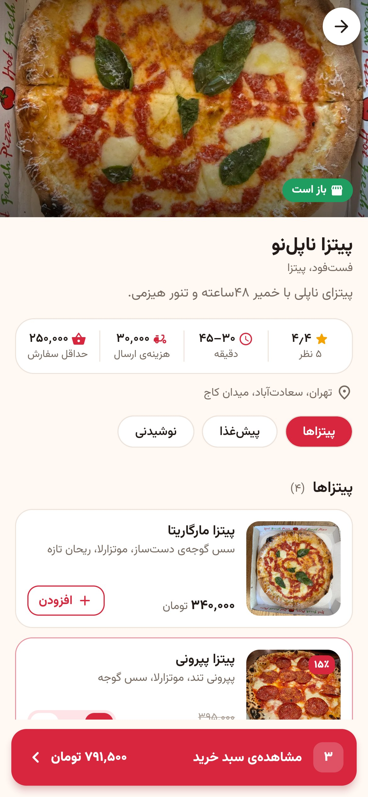
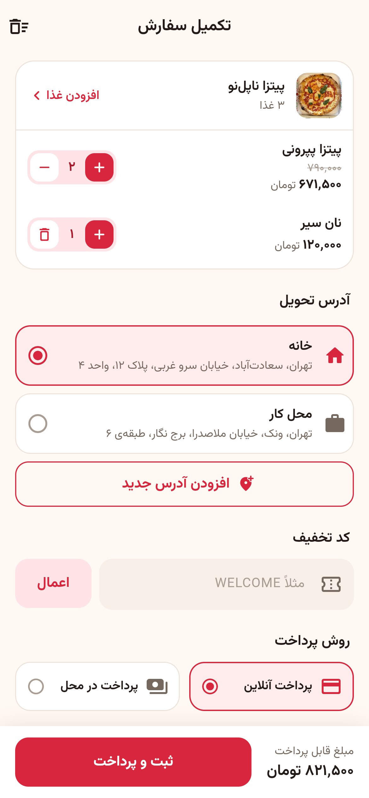
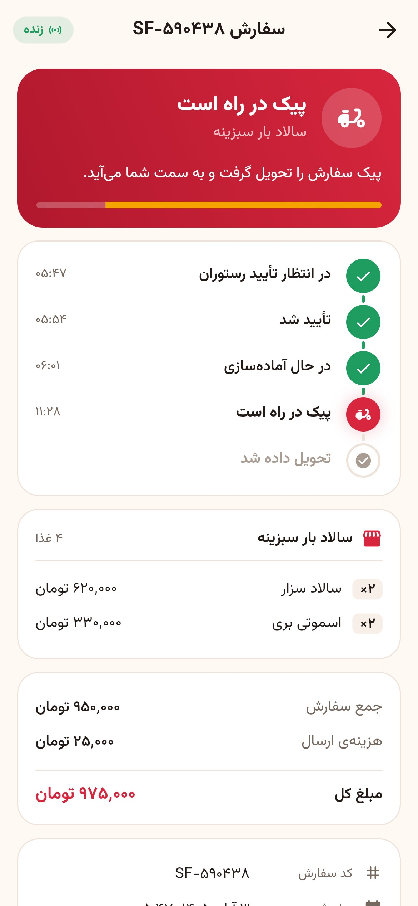
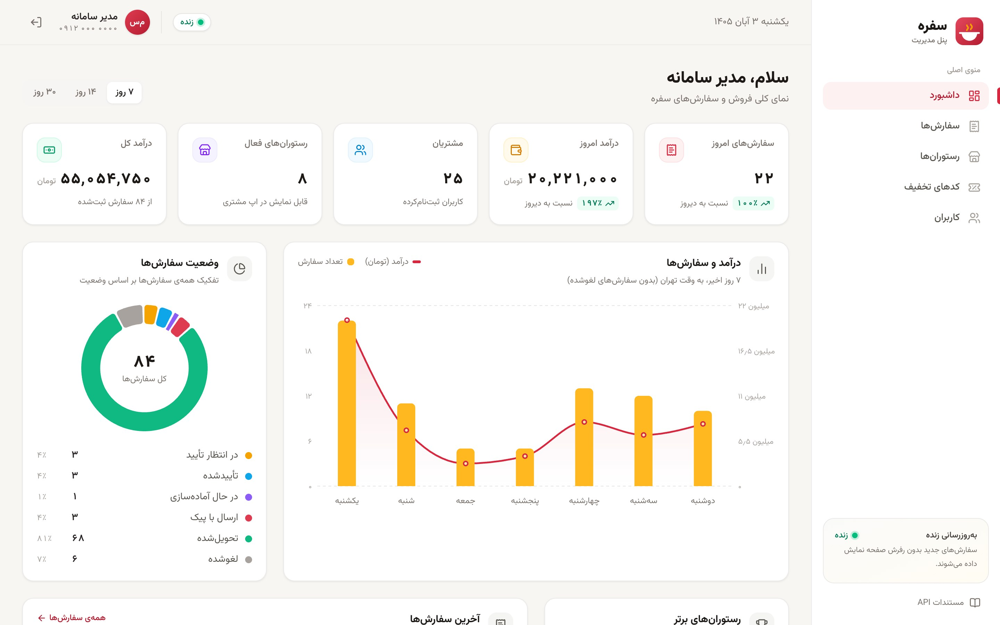
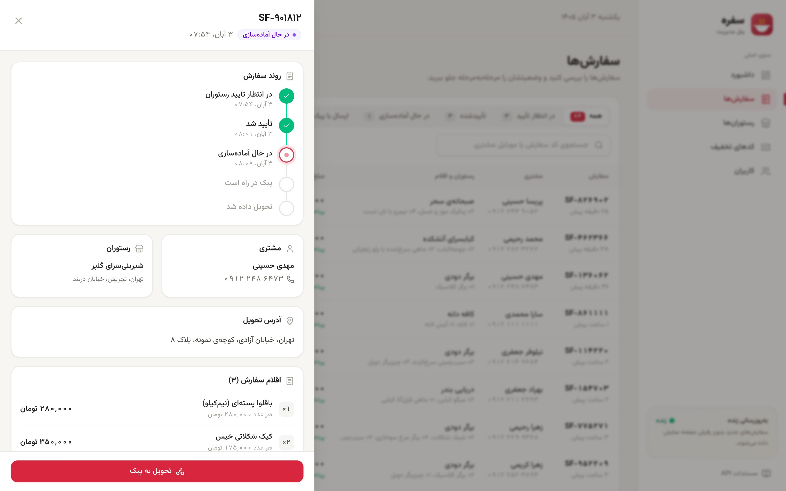
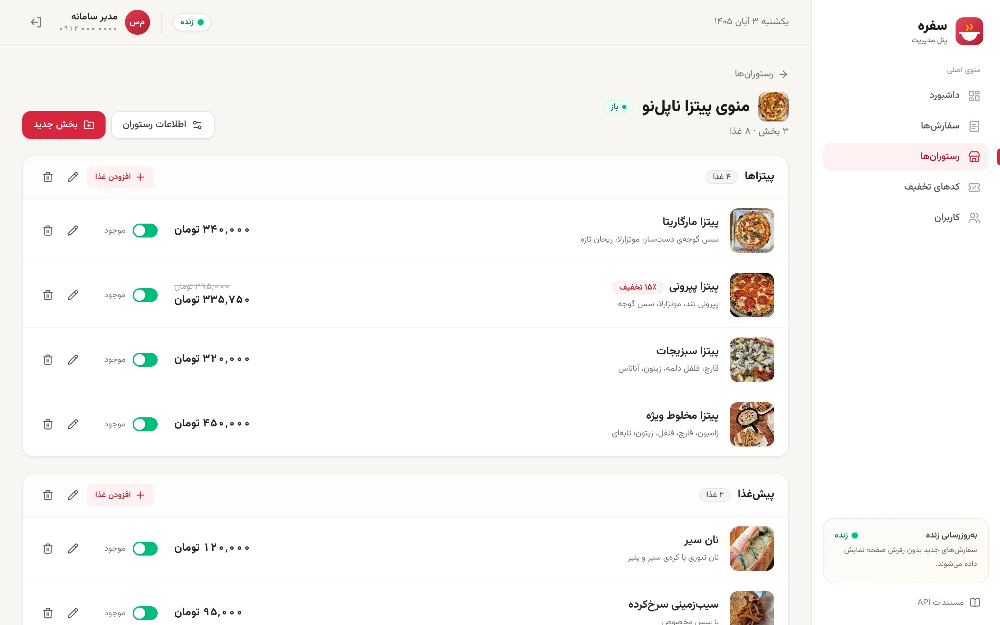

# سفره — پلتفرم سفارش آنلاین غذا

اپلیکیشن موبایل (Flutter) + بک‌اند (NestJS) + پنل مدیریت وب (Next.js) — یک نمونه‌ی کامل و مستند از معماری استاندارد یک سرویس سفارش غذا، شبیه اسنپ‌فود.

> **Sofreh** is a full-stack food-delivery demo: Flutter app, NestJS + PostgreSQL + Redis API with OpenAPI docs,
> Next.js admin panel, Docker/Nginx deployment and CI. Technical docs are in English in [`docs/`](docs).

| خانه | منوی رستوران | تکمیل سفارش | پیگیری زنده |
|---|---|---|---|
|  |  |  |  |



| مدیریت زنده‌ی سفارش‌ها | مدیریت منو |
|---|---|
|  |  |

## امکانات

**اپلیکیشن مشتری (Flutter — اندروید، iOS و وب)**
- ورود با شماره‌ی موبایل و کد یک‌بارمصرف (OTP)
- جستجوی رستوران و غذا، فیلتر بر اساس دسته‌بندی، مرتب‌سازی (امتیاز، زمان و هزینه‌ی ارسال)، فقط رستوران‌های باز
- منوی رستوران با بخش‌بندی، تخفیف روی غذا، غذاهای ناموجود، نظرات کاربران
- سبد خرید، آدرس‌های ذخیره‌شده، کد تخفیف، پرداخت آنلاین (درگاه شبیه‌سازی‌شده) یا در محل
- پیگیری زنده‌ی سفارش (WebSocket)، لغو سفارش، ثبت امتیاز و نظر، تاریخچه‌ی سفارش‌ها

**پنل مدیریت (Next.js)**
- داشبورد: فروش و سفارش امروز، نمودار ۷ روز اخیر، وضعیت سفارش‌ها، رستوران‌های برتر
- مدیریت زنده‌ی سفارش‌ها: اعلان سفارش جدید و تغییر وضعیت لحظه‌ای
- مدیریت رستوران‌ها، بخش‌های منو و غذاها با آپلود و فشرده‌سازی خودکار عکس
- مدیریت کدهای تخفیف و کاربران (نقش و فعال/غیرفعال)

**بک‌اند (NestJS + TypeScript)**
- REST API نسخه‌دار (`/api/v1`) با مستندات OpenAPI/Swagger
- PostgreSQL با Prisma و migration؛ Redis برای کد OTP، توکن‌ها، محدودیت درخواست و کش
- احراز هویت JWT با refresh token قابل ابطال، نقش‌ها (مشتری/مدیر)، محدودیت نرخ درخواست
- قوانین قیمت‌گذاری، تخفیف و وضعیت سفارش به‌صورت توابع خالص با تست واحد؛ تست end-to-end
- رویدادهای لحظه‌ای با Socket.IO

**زیرساخت**
- Docker Compose (PostgreSQL، Redis، API، پنل، Nginx) — قابل اجرا روی سرورهای ایرانی
- Nginx به‌عنوان reverse proxy (API، پنل، WebSocket، تصاویر)
- CI با GitHub Actions: lint، تست و build هر سه بخش + ساخت ایمیج‌های Docker

## اجرای سریع

```bash
docker compose up -d postgres redis
cd apps/api && cp .env.example .env && npm install && npx prisma migrate deploy && npm run db:seed && npm run start:dev
```

جزئیات کامل (پنل، اپ و اجرا با Docker) در [راهنمای توسعه](docs/DEVELOPMENT.md).
ورود آزمایشی: مدیر `09120000000`، مشتری `09121111111` (در حالت توسعه کد ورود روی صفحه نمایش داده می‌شود). کد تخفیف: `WELCOME`.

## مستندات

| سند | محتوا |
|---|---|
| [docs/ARCHITECTURE.md](docs/ARCHITECTURE.md) | معماری، ساختار پوشه‌ها، تصمیم‌های فنی، امنیت |
| [docs/API.md](docs/API.md) | مرجع API با نمونه‌ی واقعی درخواست و پاسخ، رویدادهای WebSocket |
| [docs/DATABASE.md](docs/DATABASE.md) | نمودار ER، جدول‌ها، کلیدهای Redis |
| [docs/DEVELOPMENT.md](docs/DEVELOPMENT.md) | نصب، اجرا، دستورات روزمره، راهنمای افزودن قابلیت جدید |
| [docs/DEPLOYMENT.md](docs/DEPLOYMENT.md) | استقرار با Docker روی سرور، HTTPS، پشتیبان‌گیری |
| `http://localhost:4100/api/docs` | Swagger (مستندات تعاملی API) |

## ساختار پروژه

```
apps/
  api/       NestJS + Prisma (REST، WebSocket، Swagger، تست‌ها)
  admin/     پنل مدیریت Next.js
  mobile/    اپلیکیشن Flutter
infra/nginx/ تنظیمات Nginx
docs/        مستندات
docker-compose.yml
.github/workflows/ci.yml
```

---

نسخه‌ی نمایشی برای نمونه‌کار — طراحی و توسعه: علی کهرودی. عکس‌های غذا از منابع آزاد (CC0) هستند؛ منابع در
[`apps/api/prisma/seed-images/CREDITS.md`](apps/api/prisma/seed-images/CREDITS.md).
