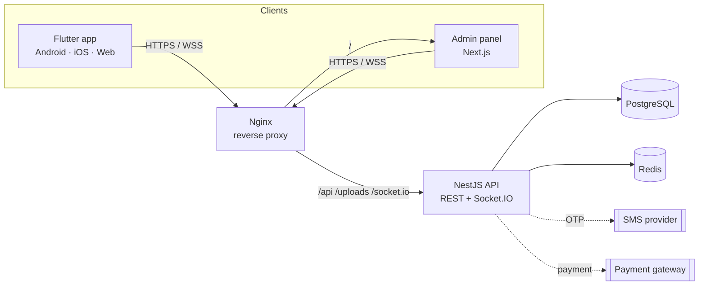

# Architecture



| Part | Tech | Folder |
|---|---|---|
| API | NestJS 12, TypeScript (ESM), Prisma, class-validator, Socket.IO, Swagger | `apps/api` |
| Admin panel | Next.js 16 (App Router), TypeScript, Tailwind CSS | `apps/admin` |
| Mobile app | Flutter 3, Riverpod, go_router, Dio | `apps/mobile` |
| Data | PostgreSQL 17, Redis 7 | `docker-compose.yml` |
| Infra | Docker, Nginx, GitHub Actions | `docker-compose.yml`, `infra/`, `.github/` |

## API design (`apps/api/src`)

One NestJS module per feature; each module owns its controller, service and DTOs.

```
src/
  main.ts            bootstrap (port, logging)
  setup.ts           shared app config: security headers, CORS, validation, static files, Swagger
  app.module.ts      wires modules + global guards (rate limit, auth)
  config/env.ts      typed, validated environment variables (fails fast on bad config)
  common/            auth guard + @Public/@Roles/@CurrentUser decorators, pagination, phone utils
  prisma/  redis/    database and cache clients (global modules)
  auth/              OTP login, JWT access tokens, rotating refresh tokens, SMS adapter
  users/             profile and saved addresses
  catalog/           cuisines, restaurant search/filter, menus, reviews (Redis-cached)
  orders/            checkout, simulated payment, cancel, reviews
    order-rules.ts   pure pricing / discount / status-flow rules (unit-tested)
  realtime/          Socket.IO gateway (/realtime) + service used to push order events
  admin/             dashboard stats, order board, restaurant/menu/discount/user management, uploads
  health/            liveness check for Docker and monitoring
```

**Request pipeline:** Helmet → CORS → rate limiter (global 120/min/IP, stricter on login) → `AuthGuard`
(JWT, `@Public()` routes skip it, `@Roles('ADMIN')` checks the role) → `ValidationPipe` (whitelists DTO fields,
returns the first Persian error in `message`) → controller → service → Prisma.

**Key decisions**

- **Prices are always computed on the server.** Clients send dish IDs and quantities only.
- **Orders keep a snapshot** of names and prices, so menu edits never rewrite history.
- **Business rules are pure functions** (`order-rules.ts`) with unit tests; services do I/O only.
- **Short-lived state lives in Redis** (OTP codes, refresh tokens, cache) with TTLs, not in PostgreSQL.
- **Replaceable integrations:** `SmsService` logs instead of sending, and `POST /orders/:id/pay` simulates the
  gateway. Swapping in Kavenegar/SMS.ir or ZarinPal/IDPay touches only those two places.
- **Real-time** uses Socket.IO rooms: `user:<id>` for each customer and `admins` for the panel.

## Security

- OTP: 5-digit codes, 2-minute expiry, 60 s resend cooldown, 5 attempts max, 5 requests/min/IP.
- Short-lived JWT access tokens (15 min) and opaque refresh tokens stored in Redis (revocable, rotated on use).
- Role checks on every admin route; customers can only see their own orders and addresses (404 otherwise).
- Strict input validation (unknown fields are rejected), file-type check and size limit on uploads.
- `OTP_DEV_MODE` cannot be enabled in production (the API refuses to start).
