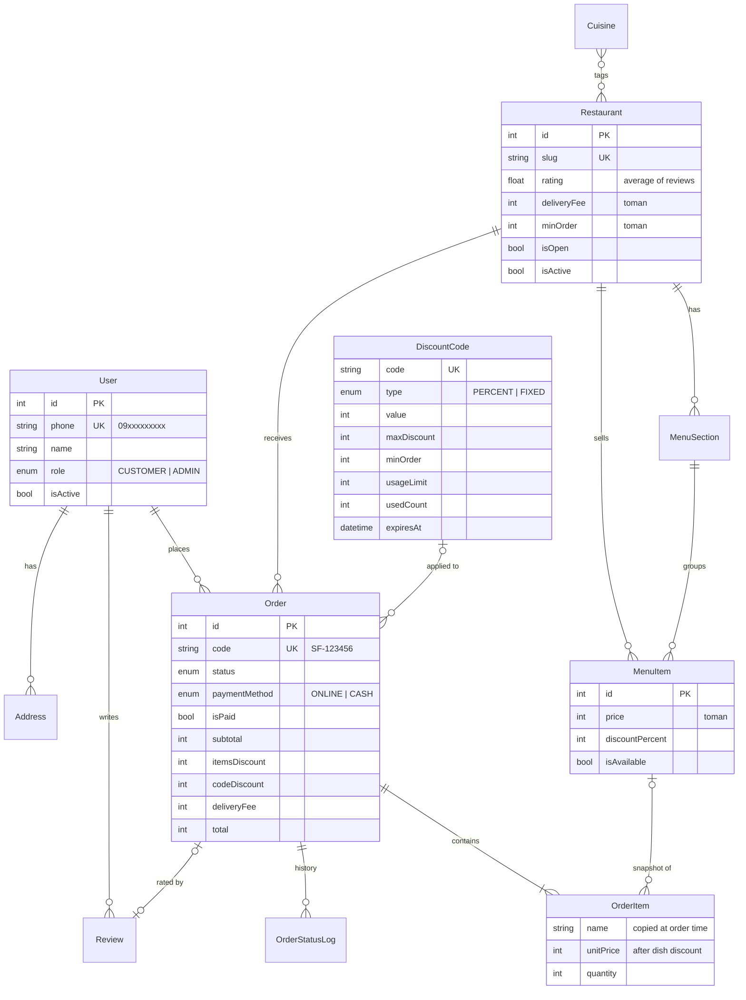
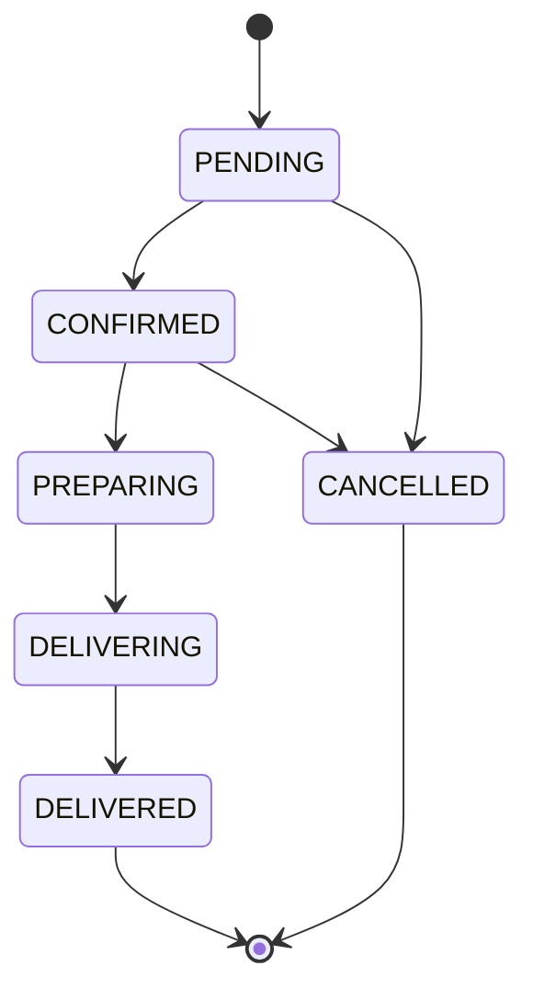

# Database

PostgreSQL 17, accessed through [Prisma](https://www.prisma.io/) (`apps/api/prisma/schema.prisma` is the source of truth).
Migrations live in `apps/api/prisma/migrations/` and are applied automatically when the API container starts
(`prisma migrate deploy`). Redis holds only short-lived data (see the end of this page).

## Entity-relationship diagram



## Tables

| Table | Purpose | Notes |
|---|---|---|
| `User` | Customers and admins | Created on first OTP login. Role `ADMIN` is given to phones listed in `ADMIN_PHONES`. |
| `Address` | Saved delivery addresses | Optional `lat`/`lng` for a future map picker. Deleted with the user. |
| `Cuisine` | Restaurant categories | `icon` is a key the apps map to an icon. Many-to-many with `Restaurant` (`_CuisineToRestaurant`). |
| `Restaurant` | Vendors | `rating`/`ratingCount` are denormalised from `Review` for fast listing; recalculated on every review. `isActive=false` hides it everywhere; `isOpen=false` shows it as closed. |
| `MenuSection` | Menu groups («پیتزاها», «نوشیدنی») | Ordered by `sortOrder`. |
| `MenuItem` | Dishes | Final price = `round(price × (100 − discountPercent) / 100)`. |
| `Order` | Customer orders | Totals are calculated on the server and stored, so reports never depend on today's prices. |
| `OrderItem` | Lines of an order | Name and price are **copied** at order time; editing or deleting a dish later doesn't change old orders (`menuItemId` becomes null on delete). |
| `OrderStatusLog` | Status timeline | One row per status change; drives the tracking screen and the admin timeline. |
| `DiscountCode` | Promo codes | `usedCount` is incremented with an atomic conditional update, so a limited code can't be over-used by parallel orders. Cancelling an order gives the use back. |
| `Review` | 1–5 star ratings | One per delivered order (`orderId` is unique). |

## Order status flow



The rules live in `apps/api/src/orders/order-rules.ts` (pure functions, unit-tested). Customers can cancel only while `PENDING`.

## Indexes

Foreign keys used in filters are indexed (`userId`, `restaurantId`, `sectionId`, `orderId`), plus `Order.status` and
`Order.createdAt` for the admin board and dashboard. Unique: `User.phone`, `Restaurant.slug`, `Cuisine.slug`,
`Order.code`, `DiscountCode.code`, `Review.orderId`.

## Redis keys

| Key | Value | TTL |
|---|---|---|
| `otp:code:<phone>` | 5-digit login code | 120 s |
| `otp:cooldown:<phone>` | blocks re-sending | 60 s |
| `otp:attempts:<phone>` | wrong-code counter (max 5) | 120 s |
| `refresh:<token>` | user id (refresh tokens, rotated on use) | 30 days |
| `catalog:*` | cached cuisines, restaurant lists and menus | 60–300 s, cleared on any admin change |

## Common tasks

```bash
cd apps/api
npx prisma migrate dev --name <change>   # after editing schema.prisma: create + apply a migration
npx prisma studio                         # browse data in the browser
npm run db:seed                           # reload demo data (wipes everything)
npm run db:reset                          # drop, re-migrate and seed
```
